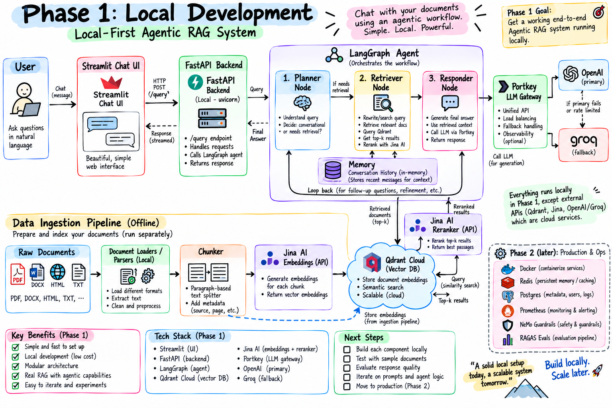

# Agentic RAG over Kubernetes docs

A question-answering agent that answers from a private document set and falls back to live web search when the documents don't cover the question. Built with LangGraph, FastAPI and Chainlit, traced with LangSmith.



## How it works

The agent is a LangGraph graph with four nodes:

1. **planner** rewrites the user question into a search query. It gets the current date so relative questions ("what changed in September") don't resolve to a stale year.
2. **retriever** embeds the query, searches Qdrant, then reranks the candidates with Cohere `rerank-v3.5` and keeps the top 5.
3. **web_search** (Tavily) runs when the best reranked score is below the confidence threshold.
4. **responder** writes the final answer from the retrieved context and streams tokens back.

The confidence threshold is 0.5. I picked it by running real queries: relevant chunks scored 0.83-0.94 and irrelevant ones 0.04-0.27, so 0.5 leaves margin on both sides. The original 0.3 let weak matches through and skipped the web fallback.

## Stack

- LangGraph and LangChain for the agent
- Qdrant for vector search, OpenAI `text-embedding-3-small` for embeddings
- Cohere for reranking, Tavily for web search
- Groq (`gpt-oss-120b`) for planning, OpenAI (`gpt-4o-mini`) for answers
- FastAPI `/query` endpoint with streaming responses
- Chainlit chat UI
- LangSmith tracing

## Run it

```bash
python -m venv .venv && source .venv/bin/activate
pip install -r requirements.txt
cp .env.example .env   # fill in your keys
```

Put your documents (PDF, DOCX, PPTX, HTML, TXT) in `DATA/`, then ingest them with `ingest_folder` in `app/ingestion.py` and `create_collection` in `app/vectorstore.py`.

```bash
uvicorn app.main:app --reload      # backend on :8000
chainlit run ui/app.py             # chat UI
```

Query the API directly:

```bash
curl -N -X POST localhost:8000/query -H "Content-Type: application/json" \
  -d '{"q": "How do CronJobs work?", "thread_id": "demo"}'
```

## Known gaps

See `NECESSARY_UPDATES.md` for the running list (chunking has no overlap, web search ranks relevance over recency).
